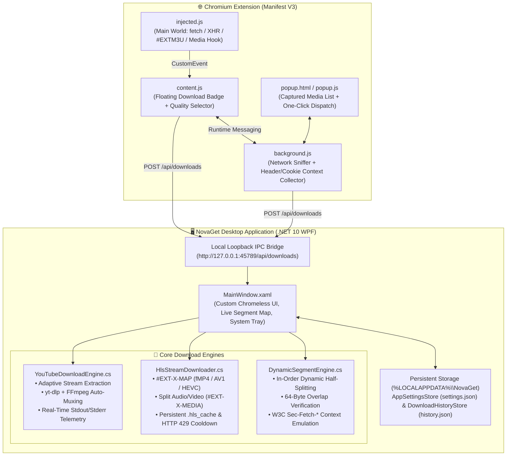

# ⚡ NovaGet — High-Performance .NET 10 Download Manager & Stream Engine

**NovaGet** is a modern, clean-room download manager and media stream engine built with **.NET 10 (WPF)** and a companion **Chromium Manifest V3** browser extension. It combines multi-connection dynamic HTTP range segmentation with an advanced HLS/fMP4 stream assembler and adaptive media pipeline.

---

## ✨ Key Features

- **⚡ In-Order Dynamic Half-Splitting Engine:** Dynamically subdivides the largest remaining active byte range (`>= 2 MB`) as worker threads finish, keeping all parallel connections saturated until the final byte is written.
- **🛡️ 64-Byte Overlap Verification:** Prevents silent file corruption from broken proxy caches or non-compliant HTTP `Range` servers by overlapping segment boundaries by 64 bytes and verifying byte-level equality on disk.
- **💾 Lock-Free Sparse File I/O:** Pre-allocates target files using Win32 `FSCTL_SET_SPARSE` and writes concurrently across worker threads via `.NET 10` `RandomAccess.WriteAsync` without post-download file concatenation bottlenecks.
- **🎞️ Advanced HLS & Fragmented MP4 (fMP4) Engine:**
  - Full support for **HLS v7 Fragmented MP4 (`#EXT-X-MAP`)** initialization headers (`ftyp` + `moov`) with H.264, HEVC, and AV1 codecs.
  - Automatic detection and parallel downloading of split **Video + Audio (`#EXT-X-MEDIA:TYPE=AUDIO`)** rendition tracks with lossless FFmpeg container muxing (`-c copy -movflags +faststart`).
  - **Content-Based Manifest Sniffing:** Detects `#EXTM3U` playlists regardless of URL file extension and filters out disguised segment chunks.
  - **Persistent Segment Cache (`.hls_cache`):** Stores downloaded segments atomically on disk so interrupted streams resume from the exact remaining segment rather than restarting from zero.
  - **Adaptive Rate-Limit Backoff (`HTTP 429 / 503`):** Honors `Retry-After` headers and coordinates a global cooldown across all concurrent workers.
- **🌐 Browser Context & W3C Fetch Metadata Sync:** Automatically forwards session context (`Referer`, `Origin`, `User-Agent`, `Cookie`, and `Sec-Fetch-*` / `Sec-CH-UA` headers) from the browser tab to the desktop engine via a local loopback bridge.
- **📺 Adaptive Streaming & `yt-dlp` Integration:** Built-in quality selector (`Best`, `1080p`, `720p`, `480p`, `MP3 Audio`) with real-time progress, speed, and ETA telemetry.
- **🖥️ Modern Chromeless WPF UI:** Custom dark-themed frameless window with a live visual segment map, persistent download history, configurable settings dialog, system tray (`NotifyIcon`) integration, and desktop notifications.

---

## 🏗️ Architecture



---

## 📂 Project Structure

```text
.
├── dotnet/                             # Core Download Engine (.NET 10 Class Library & CLI)
│   ├── Benchmark/
│   │   └── LoopbackRangeServer.cs      # Local high-speed HTTP Range benchmark server
│   ├── Engine/
│   │   ├── DynamicSegmentEngine.cs     # Parallel HTTP Range, Dynamic Half-Splitting, 64B Overlap
│   │   ├── HlsStreamDownloader.cs      # HLS/fMP4 (#EXT-X-MAP), Dual-Audio, .hls_cache, 429 Backoff
│   │   └── YtDlpStreamDownloader.cs    # yt-dlp + FFmpeg integration with real-time progress parsing
│   ├── Models/
│   │   └── SegmentState.cs             # Segment state, checkpoint, and telemetry models
│   ├── Program.cs                      # CLI entry point & engine benchmark runner
│   └── MyIdm.Engine.csproj
├── desktop/                            # NovaGet WPF Desktop Client (.NET 10 Windows)
│   ├── Assets/                         # Application icons (app.ico, icon.png)
│   ├── Services/
│   │   ├── AppSettingsStore.cs         # Persistent user preferences (%LOCALAPPDATA%\NovaGet\settings.json)
│   │   ├── BrowserBridgeServer.cs      # Local loopback IPC server (http://127.0.0.1:45789)
│   │   ├── DownloadHistoryStore.cs     # Persistent download history (%LOCALAPPDATA%\NovaGet\history.json)
│   │   └── SystemTrayService.cs        # Windows System Tray (NotifyIcon) & notifications
│   ├── ViewModels/
│   │   └── DownloadItemViewModel.cs    # Real-time observable download & segment state
│   ├── MainWindow.xaml                 # Custom chromeless dark UI & live segment visualization
│   ├── MainWindow.xaml.cs              # Main window controller & engine orchestration
│   └── MyIdm.Desktop.csproj
├── extension/                          # NovaGet Browser Extension (Chromium Manifest V3)
│   ├── manifest.json                   # MV3 configuration and permissions
│   ├── background.js                   # Network stream detector & header/cookie synchronization
│   ├── content.js / content.css        # In-page floating download button & quality selector
│   ├── injected.js                     # Main-world fetch/XHR/#EXTM3U inspector
│   └── popup.html / popup.js           # Extension toolbar popup interface
└── rust/                               # Companion Rust async segment engine benchmark
```

---

## 🚀 Getting Started

### Prerequisites
- **[.NET 10 SDK](https://dotnet.microsoft.com/download)** (Windows)
- **FFmpeg** (automatically discovered from system `PATH` or WinGet packages for stream muxing)
- **yt-dlp** (automatically discovered from system `PATH`, WinGet packages, or downloaded on demand to `%LOCALAPPDATA%\NovaGet\tools`)

### 1. Build & Run the Desktop App

```bash
# Clone the repository
git clone https://github.com/FatihG60/NovaGet.git
cd NovaGet

# Build in Release mode
dotnet build desktop/MyIdm.Desktop.csproj -c Release

# Run NovaGet Desktop
dotnet run --project desktop/MyIdm.Desktop.csproj -c Release
```

The standalone executable will be generated at:
`desktop/bin/Release/net10.0-windows/NovaGet.exe`

### 2. Load the Browser Extension (Chrome / Edge / Brave)
1. Open `chrome://extensions` in your Chromium-based browser.
2. Enable **Developer mode** in the top-right corner.
3. Click **Load unpacked** and select the `extension/` folder from this repository.

---

## ⚙️ Configuration & Storage

NovaGet stores user preferences and download history locally in:
- `%LOCALAPPDATA%\NovaGet\settings.json`
- `%LOCALAPPDATA%\NovaGet\history.json`

Downloaded files are saved by default to `~/Downloads/NovaGet` and can be customized at any time from the **Settings (`⚙`)** dialog in the application header.

---

## 📄 License

This project is licensed under the MIT License.
